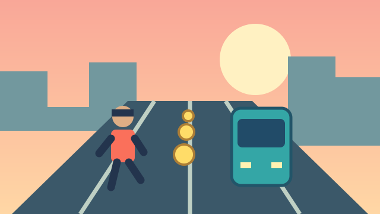

# Belancer Game

**A browser game platform with 36 playable games, interactive 2D/3D experiences, and a separate FastAPI backend for accounts, administration and server-authoritative ranked play.**

[Play the live demo](https://belancer-game.netlify.app) · [Explore the games](https://belancer-game.netlify.app/games) · [Backend repository](https://github.com/delowarai/belancer-game-backend)

## At a glance

This project combines game development with the features needed to manage a game platform. The React frontend includes a categorized catalog, responsive controls, game progression and a branded admin workspace. The companion backend handles authentication, access policies, audited administration and ranked scoring.

**The public Netlify deployment is a free, browser-only portfolio build.** Visitors can play without an account, and the developer's computer does not need to be running. Account services, shared leaderboards, administration and payments belong to the backend-connected application; they are not active on the public demo.

| Area | Implementation |
| --- | --- |
| UI | React 19, TypeScript, Vite and reusable components |
| Game development | Canvas, SVG, Three.js, Matter.js and testable TypeScript game logic |
| Platform | 36 games across memory, speed, attention, flexibility, math, word and problem-solving categories |
| Backend | FastAPI, SQLAlchemy and Alembic in the companion repository |
| Ranked play | Five backend-supported games; server validates actions and calculates results |
| Administration | Players, game settings, challenges, result moderation, content, monetization and audit records |
| Deployment | Netlify portfolio build, GitHub integration and direct-link routing |

## Try these first

These games show different parts of the implementation:

| Game | What to look for | Play |
| --- | --- | --- |
| **Metro Run** | Procedural Three.js environment, three-lane movement, jump/slide collisions, power-ups, outfits and sound controls | [Open game](https://belancer-game.netlify.app/play/metro-run) |
| **Highway Rush** | 3D driving, AI competitors, multiple modes, garage customization and progression | [Open game](https://belancer-game.netlify.app/play/highway-rush) |
| **Nuts & Bolts** | Overlapping SVG plates, screw transfers, Matter.js gravity, undo, hints and 20 workshop levels | [Open game](https://belancer-game.netlify.app/play/nuts-bolts) |
| **Bottle Garden** | 24 sorting puzzles, legal pour rules, animated bottle movement, hints and undo | [Open game](https://belancer-game.netlify.app/play/bottle-garden) |
| **Bird Launch** | Drag-and-release aiming, physics-based collisions and 30 progressively harder districts | [Open game](https://belancer-game.netlify.app/play/bird-launch) |
| **Brain Quest** | 12 notebook-style puzzles with tap, drag, reveal and learning feedback | [Open game](https://belancer-game.netlify.app/play/brain-quest) |
| **Snake Arena** | Canvas rendering, AI opponents, mini-map, game modes, cosmetics and volume settings | [Open game](https://belancer-game.netlify.app/play/snake-arena) |
| **Mini Sudoku** | Multiple board sizes, unique puzzles, notes, keyboard controls and guided hints | [Open game](https://belancer-game.netlify.app/play/mini-sudoku) |

<p align="center">
  
  
  
</p>

*Game cover illustrations above; open the links to see the playable experiences.*

## What I built

- A responsive game catalog with skill categories, individual game pages and illustrated covers.
- Interactive game experiences with dedicated engines and presentation layers, rather than one shared quiz template for every game.
- Keyboard, mouse and touch controls where supported, including swipe controls, drag interactions and on-screen buttons.
- Progression systems with level unlocking, replay, stars, cosmetic rewards, local saves and optional account synchronization in the full application.
- Pause/resume behavior, sound settings, loading states and game error boundaries.
- A Belancer visual theme using deep teal, lime, mint and cream, with light/dark presentation.
- A responsive admin dashboard with summary metrics, backend-recorded activity charts, recent changes and management workflows.
- A dedicated deployment mode that makes the playable demo independent of the backend and the developer's PC.

The companion backend implements session authentication, account settings, versioned game configuration, per-game rankings, score moderation, premium access policies and payment-provider integration code. Administrative mutations require a reason and produce an audit record.

## Architecture and important decisions

```text
Public portfolio deployment
Netlify -> React application -> TypeScript game engines
                              -> Canvas / SVG / Three.js / Matter.js
                              -> Browser-local progress

Backend-connected application
React application -> same-origin /api -> FastAPI
                                        -> SQLAlchemy database
                                        -> Account, ranking and admin services
                                        -> Verified payment notifications
```

**Practice and ranked scores are separated.** Practice runs can execute locally. In ranked play, the backend validates recorded actions and computes the result; it does not accept a browser score as authoritative. Rankings are separated by game and configuration profile so unrelated games and rule sets are not combined.

**Game logic is separated from rendering.** Modules in `src/games/` define rules, progression and simulation. Components in `src/game-shell/` provide the playable interface. This makes core behavior easier to test independently of the DOM.

**The portfolio build is explicit.** `VITE_PORTFOLIO_DEMO=true` supplies the local catalog and free access without API requests for those services. The regular application build retains backend integration. The public demo does not pretend to provide authenticated accounts or shared rankings.

**Progress has a clear scope.** Demo progress stays in the visitor's browser. Clearing site data resets it; it does not transfer between devices. In the full application, supported campaigns can synchronize with signed-in accounts.

## Run locally

### Free portfolio mode — no backend required

Requirements: **Node.js 22+** and npm.

```bash
npm ci
npm run dev -- --mode portfolio
```

Open `http://localhost:5176`.

Build and preview the static demo:

```bash
npm run build:portfolio
npm run preview
```

Use the preview URL printed by Vite. Netlify reads `netlify.toml` and builds the same portfolio mode. The routing fallback allows direct links such as `/play/metro-run` to open correctly.

### Full application — frontend and backend

Start the companion backend on port `8000` following its [setup instructions](https://github.com/delowarai/belancer-game-backend#readme), then run:

```bash
npm ci
npm run dev
```

The frontend runs on port **5176** and proxies `/api` to `http://127.0.0.1:8000`. `.env.example` documents the optional backend proxy override. Keep one hostname consistent during login because cookies are hostname-specific.

```bash
npm run build
```

A normal Vite preview serves static assets; it does not supply the development API proxy. A hosted full application needs an API routing setup and a persistent database.

## Tests and validation

```bash
# Frontend game-engine tests
npm test

# TypeScript checks and production bundling
npm run build
npm run build:portfolio

# Run in the companion backend repository
python -m pytest tests -q
```

Engine tests cover behavior such as valid moves, puzzle solutions, physics interactions, progression, collision handling and malformed saved data. Backend tests cover authentication, authorization, ranked sessions, moderation, access policies and payment verification.

The latest backend validation completed with **85 passing tests**. The portfolio production build also passed. Automated tests do not replace gameplay, device and accessibility checks.

## Repository guide

```text
src/
  api/              HTTP client and portfolio-mode behavior
  components/       Shared UI, access handling and save coordination
  games/            Game rules, simulation, level data and catalog
  game-shell/       Playable game screens and rendering
  pages/            Catalog, account, billing and administration UI
  theme.css         Belancer color tokens
public/
  game-covers/      Individual SVG game cover illustrations
tests/              Game-engine regression tests
netlify.toml        Portfolio build and SPA routing configuration
```

## Current scope and limitations

- The live site is a playable portfolio demonstration, not a production payment service.
- AI competitors in racing and Snake Arena are local computer opponents, not online multiplayer users.
- Local coins, stars and XP are cosmetic practice rewards with no monetary value.
- The 3D games require WebGL and hardware acceleration; performance varies by device.
- The full backend includes Stripe and SSLCommerz integration code, but live merchant credentials and payments are not enabled for this demo.
- Game difficulty and physics are handcrafted and may need further balancing through play feedback.
- These games are recreational learning activities; scores are not IQ measurements or medical assessments.

For hosting steps, see [Portfolio deployment](PORTFOLIO_DEPLOY.md). For brand tokens, see [Brand theme](docs/BRAND_THEME.md). Older development notes are preserved in [Implementation history](docs/IMPLEMENTATION_HISTORY.md).
